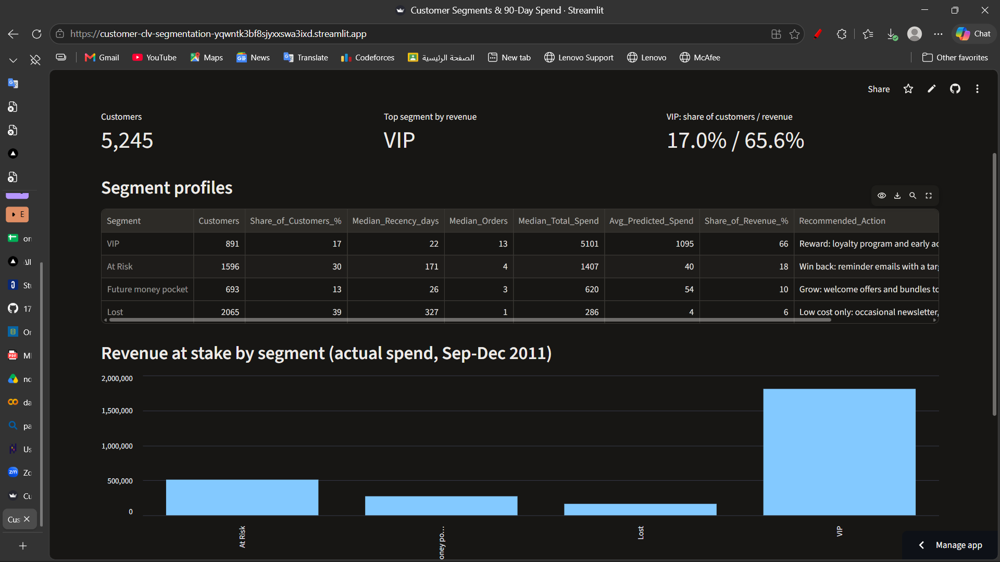
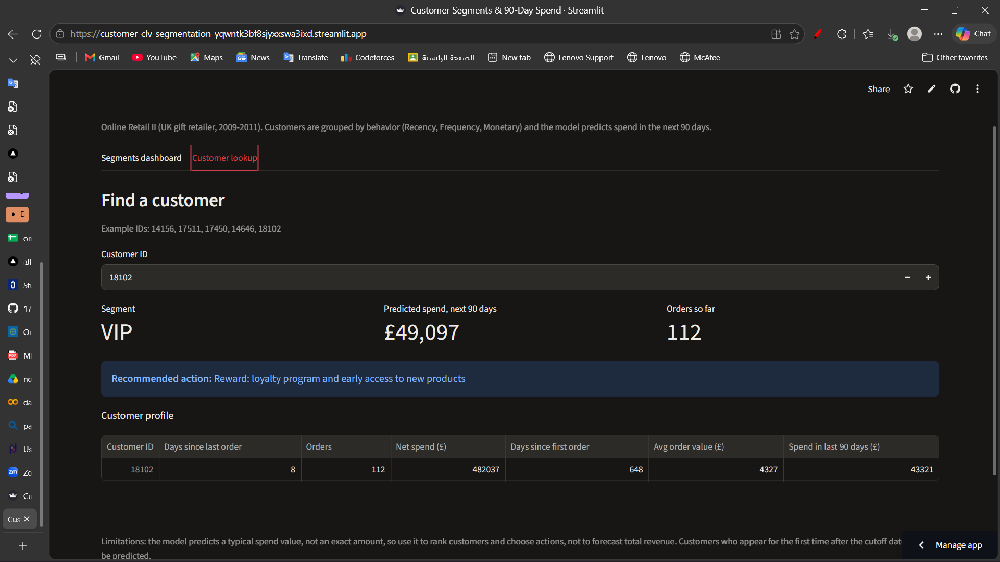

# Customer Lifetime Value & Segmentation Engine

Group online-retail customers by behavior and predict how much each one will spend in the next 90 days, so marketing knows **who to reward, who to win back, and where not to spend**.

**Live app:** https://customer-clv-segmentation-yqwntk3bf8sjyxxswa3ixd.streamlit.app/




> The free hosting may put the app to sleep after a period of inactivity. If you see a "wake up" button, click it and wait about a minute.

---

## 1. Problem

An online gift retailer treats every customer the same. The marketing team needs to decide **who to reward, who to win back, and how to split the budget** for the next quarter.

| | |
|---|---|
| **Who has the problem** | The marketing team of an online retailer |
| **Decision supported** | Which customers get loyalty rewards, win-back offers, or no spend |
| **Task 1 (unsupervised)** | Segment customers with RFM features and K-Means |
| **Task 2 (supervised)** | Regression: predict `next_90d_spend` (net spend in the 90 days after a cutoff date; 0 for customers who do not buy) |
| **Business metric** | MAE in pounds: the average error per customer, easy for a marketing manager to read. RMSE and R² are reported as well |

## 2. Data

- **Source:** [Online Retail II, UCI Machine Learning Repository](https://archive.ics.uci.edu/dataset/502) (not included in this repo because of its size)
- **Size:** 1,067,371 rows x 8 columns, 2009-12-01 to 2011-12-09. Each row is one product line inside an invoice.
- **Cleaning:** removed rows without Customer ID (about 23%), non-product codes (postage, discounts, manual entries, bank charges, tests) and zero-price rows. Kept returns (to measure *net* spending), large wholesale orders and duplicate rows. For example, the two largest orders (invoices 541431 and 581483) were fully cancelled minutes later, so their net value is zero.
- **Result:** 820,567 clean rows and 5,245 customers with usable history.

## 3. Approach

1. **Time cutoff to avoid leakage:** features come from purchases before `2011-09-11`; the target is the net spend in the following 90 days.
2. **Features:** Recency, Frequency, Monetary, plus tenure, number of unique products, average order value, return share, and spend and orders in the 90 days before the cutoff.
3. **Split before fitting anything:** 80/20 split by customer (stratified by buyer / non-buyer). Scalers, K-Means and models are fitted on the training set only.
4. **Segmentation:** `log1p` + `StandardScaler`, K-Means with k = 4 (silhouette 0.377, elbow flattens after 4), compared with hierarchical clustering (silhouette 0.309, agreement ARI 0.61). PCA is used for visualization.
5. **Regression:** baselines plus Ridge, Random Forest and Gradient Boosting, trained on `log1p(target)`, 5-fold cross-validation and randomized hyperparameter search on the training set only.

## 4. Results

### Segments (all 5,245 customers)

| Segment | Customers | Share of customers | Median days since last order | Median orders | Share of revenue (Sep-Dec 2011) | Recommended action |
|---|---:|---:|---:|---:|---:|---|
| VIP | 891 | 17% | 22 | 13 | 66% | Reward: loyalty program and early access |
| At Risk | 1,596 | 30% | 171 | 4 | 18% | Win back: reminder emails with a targeted discount |
| Future money pocket | 693 | 13% | 26 | 3 | 10% | Grow: welcome offers and bundles |
| Lost | 2,065 | 39% | 327 | 1 | 6% | Low cost only: occasional newsletter, no discounts |

**17% of customers generate about 66% of the revenue**, while 39% of customers generate about 6%.

### Spend prediction

Cross-validation on the training set (5 folds, MAE in £):

| Model | MAE | Note |
|---|---:|---|
| Baseline: predict the mean | 709 | |
| Baseline: predict zero | 529 | strongest baseline |
| Ridge | 519 | unstable after converting back from log values |
| Gradient Boosting (tuned) | 406 | |
| **Random Forest (tuned)** | **403** | selected |

Final scores on the untouched **test set** (1,049 customers):

| Model | MAE (£) | RMSE (£) | R² |
|---|---:|---:|---:|
| Baseline: predict zero | 509 | 3,422 | -0.02 |
| Baseline: train mean | 693 | 3,384 | 0.00 |
| **Random Forest (tuned)** | **392** | **2,535** | **0.44** |

The test result is a 23% lower average error than the strongest baseline and matches the cross-validation estimate, so there is no sign of overfitting.

### Error analysis

- The model recognizes non-buyers well (MAE £26 for the 56% of customers who do not buy), but 96% of the total error comes from customers who do buy.
- Errors are concentrated in large customers: the VIP segment causes about 63% of the total error and a single customer causes about 19%.
- Predictions are biased low for large customers, because the model is trained on log values and returns a typical rather than an average spend.

## 5. Business recommendations

1. **Protect the VIP segment first.** Rewards and early access are worth more than any other action.
2. **Win back the At Risk segment.** It is the second largest source of future revenue and almost half of its customers still buy.
3. **Do not spend on the Lost segment.** Only about 20% buy again; use low-cost newsletters.
4. **Use predicted spend to rank customers inside each segment** and focus the budget on the top of the list.

## 6. Limitations

- One cutoff date only, and the target window (Sep-Dec 2011) includes the Christmas peak, so the model may over-predict in quieter seasons.
- Customers who appear for the first time after the cutoff, and sudden large wholesale orders, cannot be predicted from past behavior.
- Predictions are typical values, not averages: use them to **rank customers and choose actions**, not to forecast total revenue.
- Segments overlap (silhouette 0.377) and "Future money pocket" is the least stable segment.
- Only transaction data is available (no demographics, product categories or marketing history).

## 7. Run it yourself

```bash
# the app only
pip install -r app/requirements.txt
streamlit run app/app.py
```

To re-run the analysis, download the dataset from the UCI link above, save it as `online_retail_II.xlsx` next to the notebook, and run `next_gen_final_project.ipynb` from top to bottom. The notebook rebuilds the model files in `app/`.

## 8. Repository structure

```
.
├── next_gen_final_project.ipynb   # full analysis: cleaning, EDA, RFM, K-Means, regression, evaluation
├── app/
│   ├── app.py                     # Streamlit app
│   ├── requirements.txt
│   ├── clv_model.joblib           # final pipeline and segmentation models
│   └── customers_scored.csv       # segment and predicted spend per customer
├── docs/                          # screenshots
└── README.md
```

**Tech:** Python, pandas, scikit-learn, Streamlit.
